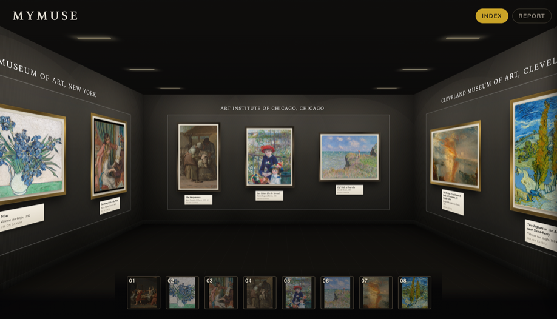
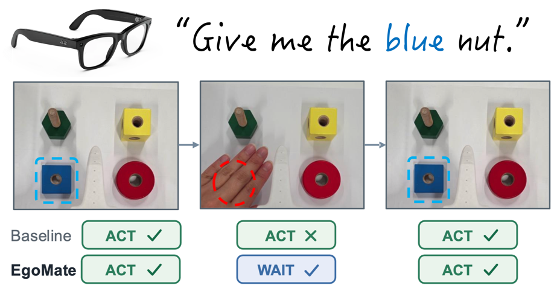
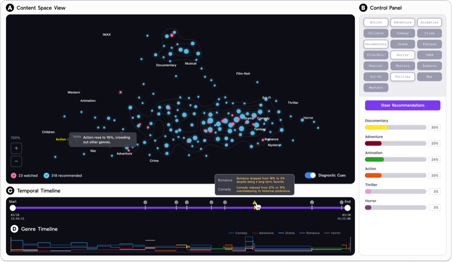
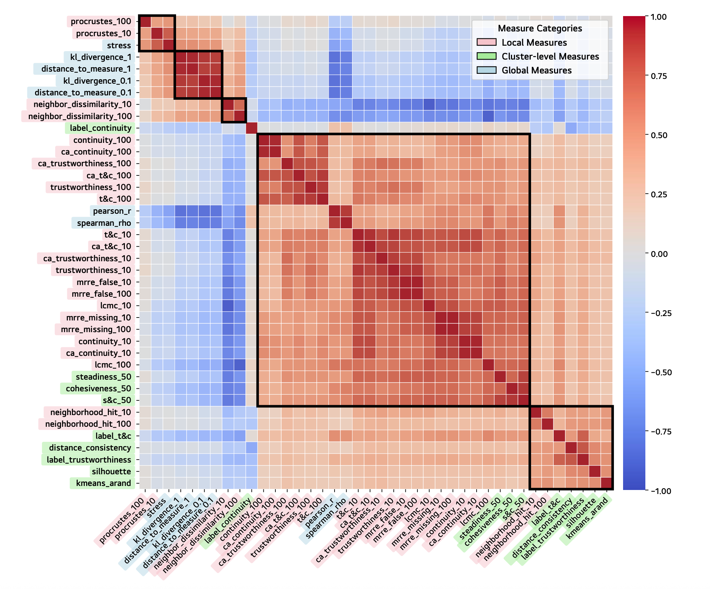
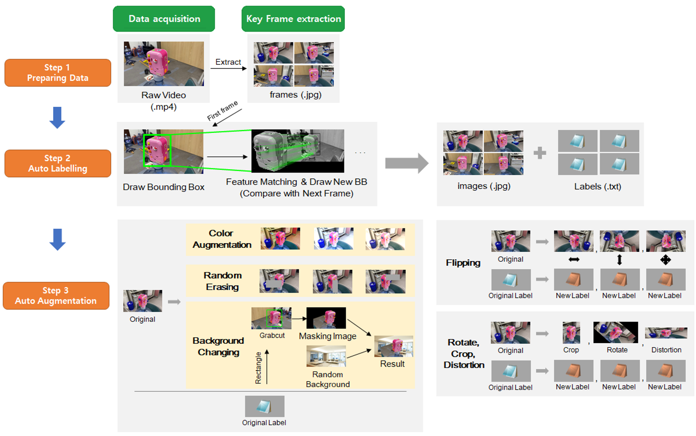
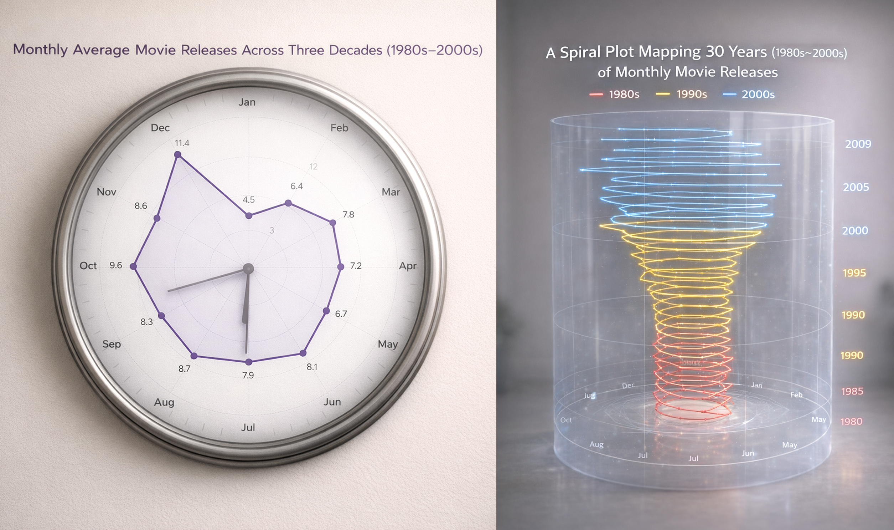
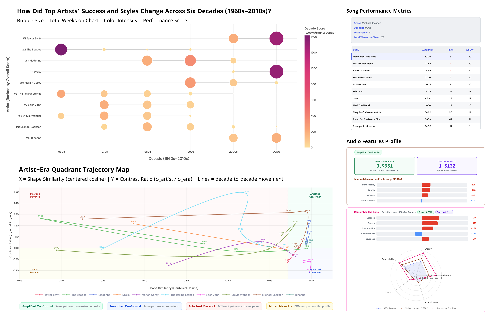

  <section class="block">
    <h2 class="block-title">About</h2>
    

      
Hi 👋&nbsp; I'm Jiyeon Bae, an M.S. student at <a href="https://www.snu.ac.kr/">Seoul National University</a>, advised by Prof. <a href="https://hcil.snu.ac.kr/people/jinwook-seo">Jinwook Seo</a> in the <a href="https://hcil.snu.ac.kr/">Human-Computer Interaction Lab</a>. I'm currently a Visiting Researcher in Prof. <a href="https://seas.harvard.edu/person/hanspeter-pfister">Hanspeter Pfister</a>&rsquo;s <a href="https://vcg.seas.harvard.edu/">Visual Computing Group</a> at <a href="https://www.harvard.edu/">Harvard University</a>.

      
My research in human&ndash;computer interaction (HCI) explores how interactive systems can help people make sense of complex information, their own experiences, and AI behavior, and act on that understanding. Drawing on <strong>data visualization</strong> and <strong>human&ndash;AI interaction</strong>, I design and evaluate systems that support <strong>sensemaking and user agency</strong> by revealing patterns people might otherwise miss, enabling reflection, and helping people shape system behavior. I am particularly interested in how visual and interactive representations shape what people notice and understand. Looking ahead, I hope to extend these ideas to AI-assisted tools for visual authoring and creative exploration.

    

    

      

        

          <svg viewBox="0 0 24 24" width="24" height="24" fill="none" stroke="#2563b8" stroke-width="1.8" stroke-linecap="round" stroke-linejoin="round"><path d="M2 12s3.6-7 10-7 10 7 10 7-3.6 7-10 7S2 12 2 12z"/><circle class="flow-pupil" cx="12" cy="12" r="3"/></svg>
        

        
Reveal

        
Make hidden patterns visible

      

      

        <svg viewBox="0 0 48 12" width="40" height="10" fill="none" stroke="#9db7da" stroke-width="1.6" stroke-linecap="round" stroke-linejoin="round"><path class="flow-line" d="M2 6h40"/><path d="M38 2l5 4-5 4"/></svg>
      

      

        

          <svg viewBox="0 0 24 24" width="24" height="24" fill="none" stroke="#2563b8" stroke-width="1.8" stroke-linecap="round" stroke-linejoin="round"><path d="M15 14c.2-1 .7-1.7 1.5-2.5 1-.9 1.5-2.2 1.5-3.5A6 6 0 0 0 6 8c0 1 .2 2.2 1.5 3.5.7.7 1.3 1.5 1.5 2.5"/><path d="M9 18h6M10 22h4"/><g class="flow-rays"><path d="M12 .5v.01M3.5 4l.01.01M20.5 4l-.01.01M1 10h.01M23 10h-.01"/></g></svg>
        

        
Understand

        
Support sensemaking and reflection

      

      

        <svg viewBox="0 0 48 12" width="40" height="10" fill="none" stroke="#9db7da" stroke-width="1.6" stroke-linecap="round" stroke-linejoin="round"><path class="flow-line" d="M2 6h40"/><path d="M38 2l5 4-5 4"/></svg>
      

      

        

          <svg viewBox="0 0 24 24" width="24" height="24" fill="none" stroke="#2563b8" stroke-width="1.8" stroke-linecap="round" stroke-linejoin="round"><path class="flow-track" d="M3 6h18M3 12h18M3 18h18"/><circle class="flow-knob flow-knob--1" cx="15" cy="6" r="2.2"/><circle class="flow-knob flow-knob--2" cx="8" cy="12" r="2.2"/><circle class="flow-knob flow-knob--3" cx="17" cy="18" r="2.2"/></svg>
        

        
Shape

        
Enable agency and adaptive assistance

      

    

  </section>

  <section class="block">
    <h2 class="block-title">News</h2>
    

      

        
Aug 2026

        
Joining the Visual Computing Group, Harvard University as a visiting researcher. 

      

      

        
Apr 2026

        
Presented two posters at IEEE PacificVis 2026 in Sydney, Australia, and received a Best Poster Award.

      

      

        
Jul 2025

        
Metric Design &ne; Metric Behavior was accepted to IEEE VIS 2025.

      

      <!-- 새 소식 추가: 

월 년도

내용

 -->
    

  </section>

  <section class="block" id="publications">
    <h2 class="block-title">Publications</h2>
    

      <article class="pub" data-tags="vis hai">
        

          
        

        

          <h3 class="pub-title">MyMuse: A Personal Museum for Continued Inquiry and Reflection</h3>
          
<strong>Jiyeon Bae</strong>, Chunggi Lee, Jinwook Seo, and Hanspeter Pfister

          
Under review at ACM CHI Conference on Human Factors in Computing Systems (CHI), 2027

          
VisualizationHuman&ndash;AI Interaction

          <a class="view-project" href="/publications/mymuse/">View Details <svg viewBox="0 0 256 256" width="12" height="12" fill="currentColor" aria-hidden="true"><path d="M200,64V168a8,8,0,0,1-16,0V83.31L69.66,197.66a8,8,0,0,1-11.32-11.32L172.69,72H88a8,8,0,0,1,0-16H192A8,8,0,0,1,200,64Z"></path></svg></a>
        

      </article>
      <article class="pub" data-tags="hai xr">
        

          
        

        

          <h3 class="pub-title">EgoMate: Egocentric Human-Robot Collaboration for Spoken Requests in Changing Shared Workspaces</h3>
          
Chunggi Lee*, Florian Zogaj*, <strong>Jiyeon Bae</strong>, Jinwook Seo, and Hanspeter Pfister

          
Under review &middot; * Equal contribution

          
Human&ndash;AI InteractionXR &amp; Wearables

        

      </article>
      <article class="pub" data-tags="vis hai">
        

          
        

        

          <h3 class="pub-title">Beyond the Feed: Trajectory-Level Interaction for Understanding and Steering Recommendations Under Short-Term Sensitivity</h3>
          
Sean Kim, Namhee Kim, <strong>Jiyeon Bae</strong>, Min Hyeong Kim, and Jinwook Seo

          
Under review at ACM CHI Conference on Human Factors in Computing Systems (CHI), 2027

          
VisualizationHuman&ndash;AI Interaction

          <a class="view-project" href="/publications/beyond-the-feed/">View Details <svg viewBox="0 0 256 256" width="12" height="12" fill="currentColor" aria-hidden="true"><path d="M200,64V168a8,8,0,0,1-16,0V83.31L69.66,197.66a8,8,0,0,1-11.32-11.32L172.69,72H88a8,8,0,0,1,0-16H192A8,8,0,0,1,200,64Z"></path></svg></a>
        

      </article>
      <article class="pub" data-tags="vis">
        

          
        

        

          <h3 class="pub-title">Metric Design &ne; Metric Behavior: Improving Metric Selection for the Unbiased Evaluation of Dimensionality Reduction</h3>
          
<strong>Jiyeon Bae</strong>, Hyeon Jeon, and Jinwook Seo

          
IEEE Visualization and Visual Analytics (VIS), 2025

          
Visualization

          

            <a href="https://arxiv.org/pdf/2507.02225" target="_blank" rel="noopener noreferrer">PDF</a>
            <a href="https://arxiv.org/abs/2507.02225" target="_blank" rel="noopener noreferrer">arXiv</a>
            <a href="https://github.com/JiyeonBae/dr-metric-selection" target="_blank" rel="noopener noreferrer">Code</a>
          

        

      </article>
      <article class="pub" data-tags="cv">
        

          
        

        

          <h3 class="pub-title">Development of 3D Reconstruction and Object Recognition Model Based on Single Dataset</h3>
          
Nahyuk Lee, Hannah Noh, <strong>Jiyeon Bae</strong>, Kyunghun Nam, Sanghyun Seo, and Kyunghyun Yoon

          
Korea Multimedia Society Summer Conference (KMMS), 2020

          
Computer Vision

          <a class="view-project" href="/publications/kmms-2020/">View Details <svg viewBox="0 0 256 256" width="12" height="12" fill="currentColor" aria-hidden="true"><path d="M200,64V168a8,8,0,0,1-16,0V83.31L69.66,197.66a8,8,0,0,1-11.32-11.32L172.69,72H88a8,8,0,0,1,0-16H192A8,8,0,0,1,200,64Z"></path></svg></a>
        

      </article>
    

  </section>

  <section class="block">
    <h2 class="block-title">Posters</h2>
    

      <article class="pub" data-tags="vis xr">
        

          
        

        

          <h3 class="poster-title">Physical Containers as Framing Conditions for Visualization in Augmented Reality</h3>
          
<strong>Jiyeon Bae</strong>, Mingyu An, Jeongin Park, Seokweon Jung, Kiroong Choe, and Jinwook Seo

          
IEEE Pacific Visualization Conference (PacificVis), 2026Best Poster Award

          
VisualizationXR &amp; Wearables

          

            <a href="https://arxiv.org/abs/2603.21637" target="_blank" rel="noopener noreferrer">arXiv</a>
            <a href="/poster-ar.pdf" target="_blank" rel="noopener noreferrer">Poster</a>
          

        

      </article>
      <article class="pub" data-tags="vis">
        

          
        

        

          <h3 class="poster-title">A Multi-Level Visual Analytics Approach to Artist&ndash;Era Alignment in Popular Music</h3>
          
<strong>Jiyeon Bae</strong> and Jinwook Seo

          
IEEE Pacific Visualization Conference (PacificVis), 2026

          
Visualization

          

            <a href="https://arxiv.org/abs/2603.21624" target="_blank" rel="noopener noreferrer">arXiv</a>
            <a href="/poster-music.pdf" target="_blank" rel="noopener noreferrer">Poster</a>
          

        

      </article>
    

  </section>

  <section class="block">
    <h2 class="block-title">Research Experience</h2>
    

      

        

          
Visiting Researcher

          
<a href="https://vcg.seas.harvard.edu/">Visual Computing Group</a>, <a href="https://www.harvard.edu/">Harvard University</a> &middot; Advisor: Prof. <a href="https://seas.harvard.edu/person/hanspeter-pfister">Hanspeter Pfister</a>

        

        
Aug 2026 &ndash; Present

      

      

        

          
Graduate Researcher

          
<a href="https://hcil.snu.ac.kr/">Human-Computer Interaction Lab</a>, Seoul National University &middot; Advisor: Prof. <a href="https://hcil.snu.ac.kr/people/jinwook-seo">Jinwook Seo</a>

        

        
Sep 2025 &ndash; Present

      

      

        

          
Research Intern

          
<a href="https://hcil.snu.ac.kr/">Human-Computer Interaction Lab</a>, Seoul National University &middot; Advisor: Prof. <a href="https://hcil.snu.ac.kr/people/jinwook-seo">Jinwook Seo</a>

        

        
Dec 2024 &ndash; Aug 2025

      

      

        

          
Undergraduate Researcher

          
Computer Graphics Lab, Chung-Ang University &middot; Advisor: Prof. <a href="https://scholar.google.com/citations?user=k1SL428AAAAJ&amp;hl=ko">Sanghyun Seo</a>

        

        
Sep 2019 &ndash; Feb 2020

      

    

  </section>

  <section class="block">
    <h2 class="block-title">Education</h2>
    

      

        

          
M.S. in Artificial Intelligence

          
Seoul National University &middot; Advisor: Prof. <a href="https://hcil.snu.ac.kr/people/jinwook-seo">Jinwook Seo</a> &middot; GPA 4.0 / 4.3

        

        
Sep 2025 &ndash; Present

      

      

        

          
B.S. in Engineering, School of Computer Art

          
Chung-Ang University &middot; GPA 4.32 / 4.5 (Summa Cum Laude)

        

        
Mar 2019 &ndash; Aug 2023

      

    

  </section>

