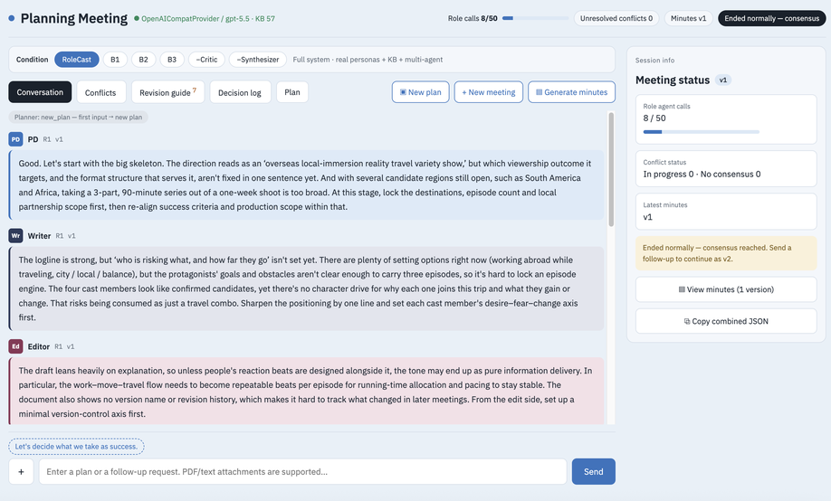
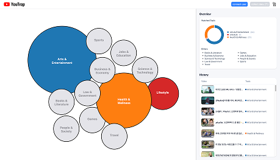
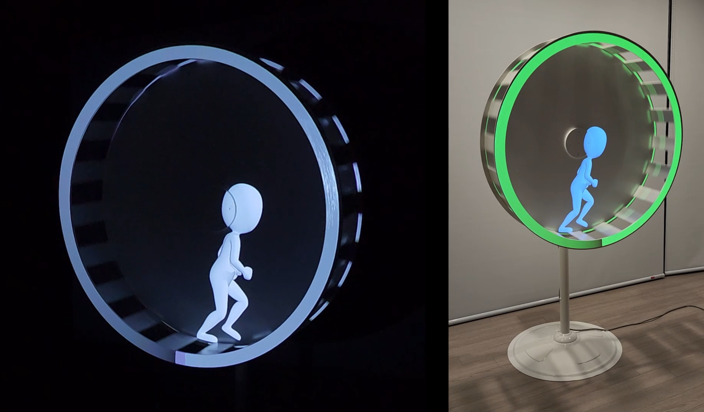
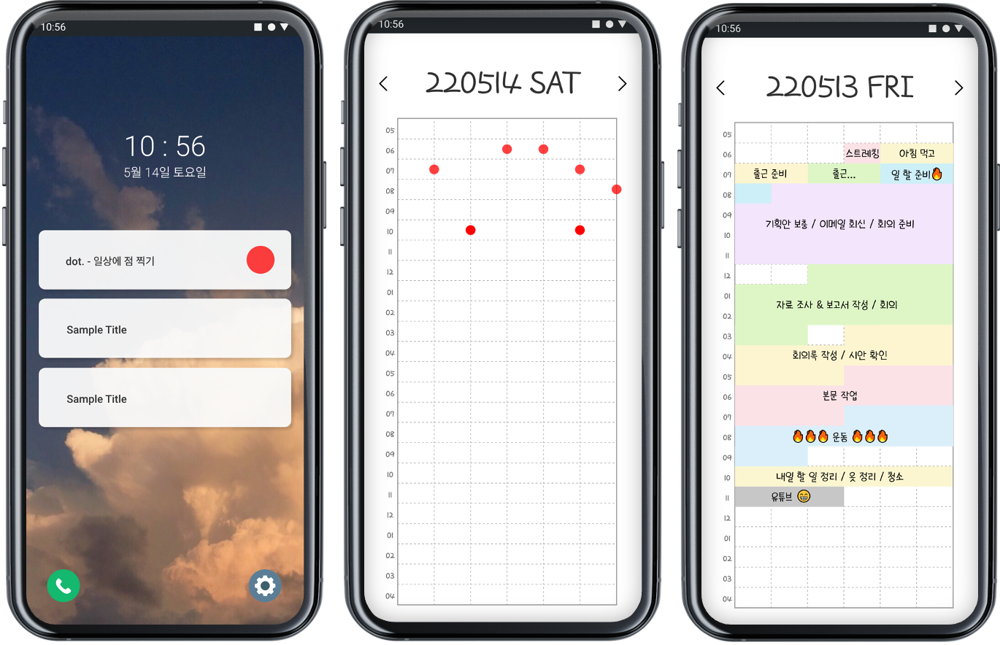
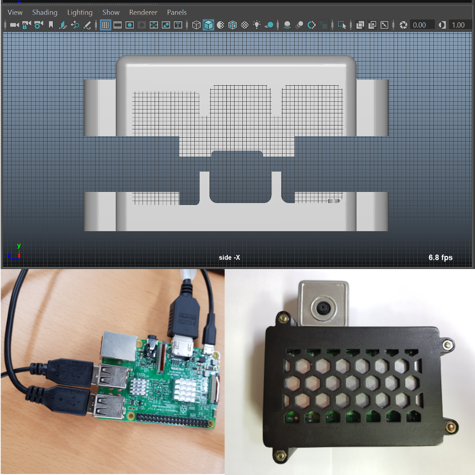
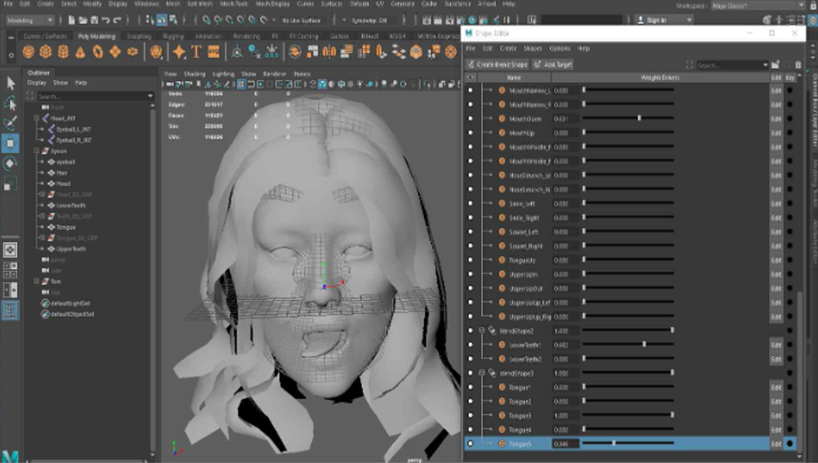
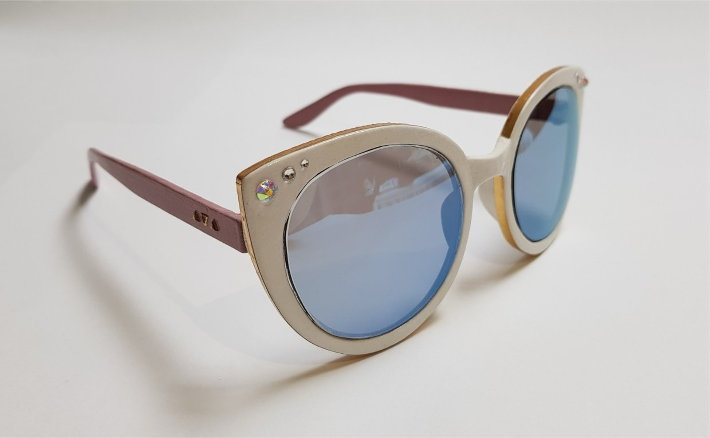
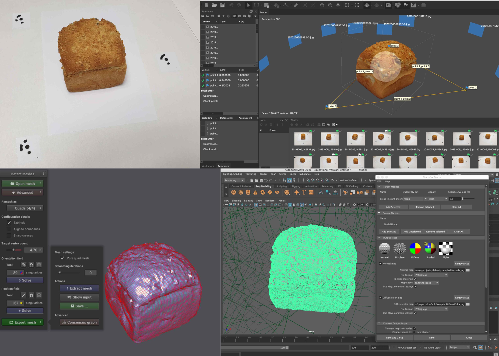

<section class="block" id="projects">
  <h2 class="block-title">Projects</h2>
  

    <article class="pub">
      

        <button type="button" class="gallery-open" data-gallery="/project/rolecast-full.jpg" aria-label="View image of RoleCast">
          
        </button>
      

      

        
Apr &ndash; Jun 2026

        <h3 class="poster-title">RoleCast: Multi-Agent Feedback for Broadcast Planning</h3>
        
Built a multi-agent system for checklist-based critique and conflict mediation across broadcast production roles, grounded in <a href="https://www.imbc.com/">MBC</a> data via dense/BM25 retrieval and evaluated with five experts.

      

    </article>
    <article class="pub">
      

        <button type="button" class="gallery-open" data-gallery="/project/youtrap-3.jpg /project/youtrap-1.jpg /project/youtrap-2.jpg" aria-label="View 3 screenshots of YouTrap">
          
          
            <svg viewBox="0 0 256 256" width="12" height="12" fill="currentColor"><path d="M216,40H72A16,16,0,0,0,56,56V72H40A16,16,0,0,0,24,88V200a16,16,0,0,0,16,16H184a16,16,0,0,0,16-16V184h16a16,16,0,0,0,16-16V56A16,16,0,0,0,216,40ZM184,200H40V88H184Zm32-32H200V88a16,16,0,0,0-16-16H72V56H216Z"></path></svg>3
          
        </button>
      

      

        
Oct &ndash; Dec 2025

        <h3 class="poster-title">YouTrap: You&rsquo;re Trapped in the YouTube Filter Bubble<a href="/youtrap.pdf" target="_blank" rel="noopener noreferrer">Poster</a></h3>
        
Designed a topic visualization Chrome extension that raises awareness of filter bubbles in YouTube recommendations, built with React, TypeScript, and D3 and evaluated in a 12-participant study.

      

    </article>
    <article class="pub">
      

        <button type="button" class="gallery-open" data-gallery="/project/sisyphus-1.jpg /project/sisyphus-2.jpg /project/sisyphus-3.jpg youtube:3kA-CfJXzQQ" aria-label="View 3 photos and a video of Sisyphus">
          
          
            <svg viewBox="0 0 256 256" width="12" height="12" fill="currentColor"><path d="M216,40H72A16,16,0,0,0,56,56V72H40A16,16,0,0,0,24,88V200a16,16,0,0,0,16,16H184a16,16,0,0,0,16-16V184h16a16,16,0,0,0,16-16V56A16,16,0,0,0,216,40ZM184,200H40V88H184Zm32-32H200V88a16,16,0,0,0-16-16H72V56H216Z"></path></svg>4
          
        </button>
      

      

        
May &ndash; Jul 2022

        <h3 class="poster-title">Sisyphus: Interactive Media Installation</h3>
        
Created Maya animations exploring repetitive daily routines, projection-mapped onto a motorized wheel in a Kinect/Unity installation that responds to viewer position; shown to 200+ visitors.

      

    </article>
    <article class="pub">
      

        <button type="button" class="gallery-open" data-gallery="/project/dot.png" aria-label="View image of Dot.">
          
        </button>
      

      

        
Mar &ndash; May 2022

        <h3 class="poster-title">Dot.: Time Management Application</h3>
        
Designed activity start/end controls to reduce logging effort, and implemented real-time logging and calendar review in React Native.

      

    </article>
    <article class="pub">
      

        <button type="button" class="gallery-open" data-gallery="/project/msc-1.jpg /project/msc-2.jpg /project/msc-3.jpg /project/msc-4.jpg" aria-label="View 4 photos of the Motion Stimulus Camera">
          
          
            <svg viewBox="0 0 256 256" width="12" height="12" fill="currentColor"><path d="M216,40H72A16,16,0,0,0,56,56V72H40A16,16,0,0,0,24,88V200a16,16,0,0,0,16,16H184a16,16,0,0,0,16-16V184h16a16,16,0,0,0,16-16V56A16,16,0,0,0,216,40ZM184,200H40V88H184Zm32-32H200V88a16,16,0,0,0-16-16H72V56H216Z"></path></svg>4
          
        </button>
      

      

        
Oct &ndash; Dec 2019

        <h3 class="poster-title">Motion Stimulus Camera</h3>
        
Built a Raspberry Pi camera with physical controls, an LCD, and a film-grain effect in a custom 3D-printed enclosure; ranked first in course project evaluations.

      

    </article>
    <article class="pub">
      

        <button type="button" class="gallery-open" data-gallery="/project/ar-avatar-full.jpg /project/ar-avatar-2.jpg" aria-label="View 2 images of the AR avatar">
          
          
            <svg viewBox="0 0 256 256" width="12" height="12" fill="currentColor"><path d="M216,40H72A16,16,0,0,0,56,56V72H40A16,16,0,0,0,24,88V200a16,16,0,0,0,16,16H184a16,16,0,0,0,16-16V184h16a16,16,0,0,0,16-16V56A16,16,0,0,0,216,40ZM184,200H40V88H184Zm32-32H200V88a16,16,0,0,0-16-16H72V56H216Z"></path></svg>2
          
        </button>
      

      

        
Oct 2019

        <h3 class="poster-title">Real-Time Facial Motion Capture and AR Avatar</h3>
        
Integrated a Fuse/Mixamo avatar with real-time facial tracking in Unity AR, customizing eye joints, skinning, and mouth/tongue blendshapes in Maya.

      

    </article>
    <article class="pub">
      

        <button type="button" class="gallery-open" data-gallery="/project/sunglasses-1.jpg /project/sunglasses-2.jpg /project/sunglasses-3.jpg /project/sunglasses-4.jpg" aria-label="View 4 photos of the 3D printed sunglasses">
          
          
            <svg viewBox="0 0 256 256" width="12" height="12" fill="currentColor"><path d="M216,40H72A16,16,0,0,0,56,56V72H40A16,16,0,0,0,24,88V200a16,16,0,0,0,16,16H184a16,16,0,0,0,16-16V184h16a16,16,0,0,0,16-16V56A16,16,0,0,0,216,40ZM184,200H40V88H184Zm32-32H200V88a16,16,0,0,0-16-16H72V56H216Z"></path></svg>4
          
        </button>
      

      

        
Sep &ndash; Oct 2019

        <h3 class="poster-title">3D Printed Cat-Eye Sunglasses</h3>
        
Designed and fabricated cat-eye sunglasses using Autodesk Maya and FDM 3D printing, with hand-finished frames and professionally fitted lenses. Selected as the top course project.

      

    </article>
    <article class="pub">
      

        <button type="button" class="gallery-open" data-gallery="/project/photogrammetry-1.jpg /project/photogrammetry-2.jpg /project/photogrammetry-3.jpg /project/photogrammetry-4.jpg /project/photogrammetry-5.jpg" aria-label="View 5 photos of the photogrammetry project">
          
          
            <svg viewBox="0 0 256 256" width="12" height="12" fill="currentColor"><path d="M216,40H72A16,16,0,0,0,56,56V72H40A16,16,0,0,0,24,88V200a16,16,0,0,0,16,16H184a16,16,0,0,0,16-16V184h16a16,16,0,0,0,16-16V56A16,16,0,0,0,216,40ZM184,200H40V88H184Zm32-32H200V88a16,16,0,0,0-16-16H72V56H216Z"></path></svg>5
          
        </button>
      

      

        
Sep 2019

        <h3 class="poster-title">Photogrammetric Reconstruction and 3D Asset Preparation<a href="https://skfb.ly/opovG" target="_blank" rel="noopener noreferrer">Sketchfab</a></h3>
        
Created textured 3D models of real-world objects through photogrammetry, retopology, and texture transfer, and published the models on Sketchfab.

      

    </article>
  

</section>

